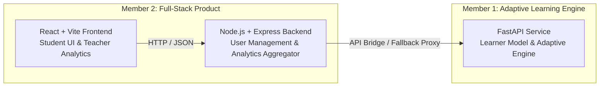

# API Contracts & Integration Guide
**Project:** Class 10 Physics: Electricity Adaptive Learning Platform  
**Member 1 (AI/ML & Adaptive Engine)** ⟷ **Member 2 (Full-Stack Product & Analytics)**

---

## Architecture Overview



---

## Endpoints Shared Between Member 1 & Member 2

### 1. `GET /api/concepts`
Returns syllabus, concepts, prerequisites, and defined misconceptions.
- **Request:** None
- **Response:**
```json
{
  "subject": "Physics",
  "grade": 10,
  "unit": "Electricity",
  "concepts": [
    {
      "id": "C1",
      "name": "Electric Charge & Current",
      "shortName": "Electric Current",
      "prerequisites": [],
      "order": 1,
      "keyFormulas": ["I = Q / t"]
    }
  ],
  "misconceptions": [
    {
      "id": "MISCON_CURRENT_CONSUMED",
      "name": "Current Consumption Fallacy",
      "conceptId": "C1",
      "remediation": "Charges are conserved..."
    }
  ]
}
```

---

### 2. `POST /api/assessment/start`
Starts a diagnostic assessment session.
- **Request Body:**
```json
{
  "studentId": "std_current",
  "studentName": "You (Student)"
}
```
- **Response:**
```json
{
  "sessionId": "diag_1793438018532",
  "totalQuestions": 6,
  "questions": [
    {
      "id": "Q101",
      "conceptId": "C1",
      "difficulty": 1,
      "type": "mcq",
      "question": "A current of 0.5 A is drawn...",
      "options": [{ "id": "A", "text": "5 C" }, { "id": "B", "text": "300 C" }]
    }
  ]
}
```

---

### 3. `POST /api/answers/submit`
Evaluates answer, updates mastery score, and identifies misconceptions.
- **Request Body:**
```json
{
  "sessionId": "diag_1793438018532",
  "studentId": "std_current",
  "questionId": "Q102",
  "selectedOption": "A",
  "numericalValue": null,
  "explanationText": "Current is used up by the light bulb"
}
```
- **Response:**
```json
{
  "isCorrect": false,
  "correctAnswer": "B",
  "feedback": "Identified Misconception: Current Consumption Fallacy.",
  "explanation": "Current is rate of charge flow...",
  "detectedMisconception": {
    "id": "MISCON_CURRENT_CONSUMED",
    "name": "Current Consumption Fallacy",
    "remediation": "Charges are neither created nor destroyed..."
  },
  "updatedMastery": {
    "conceptId": "C1",
    "score": 40,
    "delta": -10,
    "overallMastery": 48
  }
}
```

---

### 4. `GET /api/learner/progress`
Retrieves detailed concept mastery breakdown for a student.
- **Query Params:** `?studentId=std_current`
- **Response:**
```json
{
  "studentId": "std_current",
  "overallMastery": 74,
  "streakDays": 3,
  "concepts": [
    {
      "id": "C1",
      "shortName": "Electric Current",
      "mastery": 85,
      "status": "Mastered",
      "activeMisconceptions": []
    }
  ],
  "reviewsDue": []
}
```

---

### 5. `GET /api/practice/next`
Selects the next optimal question targeting weak concepts and checking prerequisite readiness.
- **Query Params:** `?studentId=std_current`
- **Response:**
```json
{
  "question": { "id": "Q104", "conceptId": "C3", "difficulty": 2, "question": "..." },
  "targetConcept": { "id": "C3", "name": "Ohm's Law" },
  "learnerMastery": 54,
  "recommendedReason": "Targeting your growth area in Ohm's Law (Mastery: 54%)"
}
```

---

### 6. `GET /api/reviews/due`
Returns concepts due for spaced repetition revision.
- **Query Params:** `?studentId=std_current`
